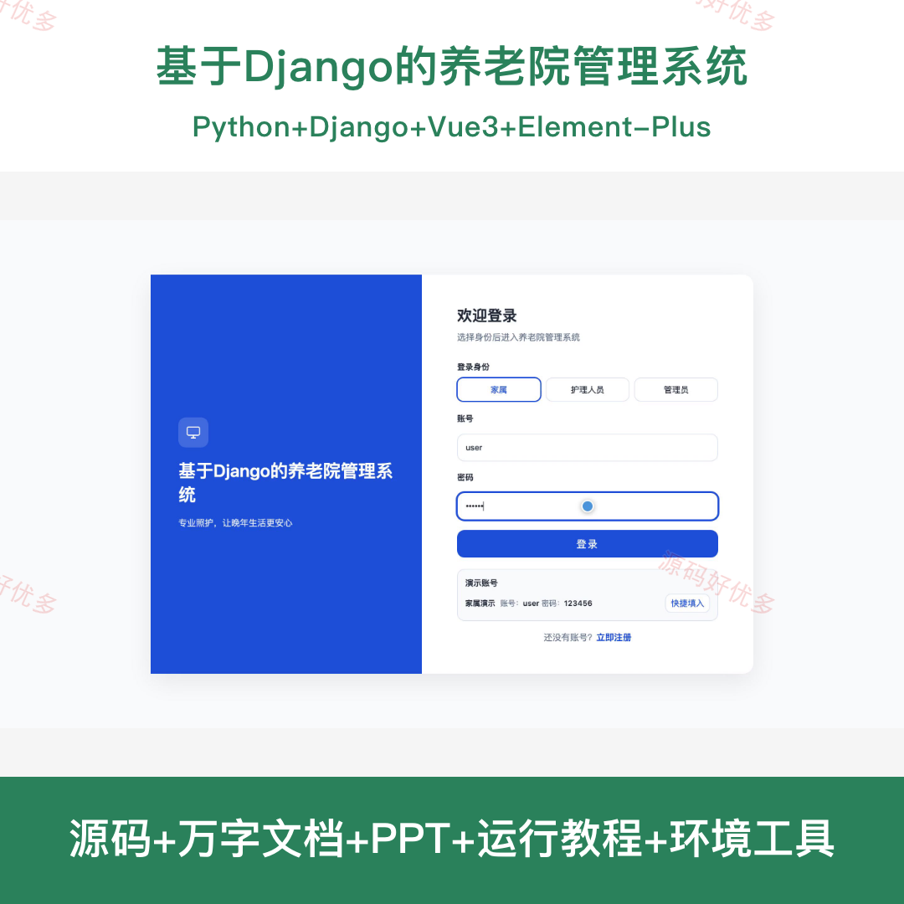
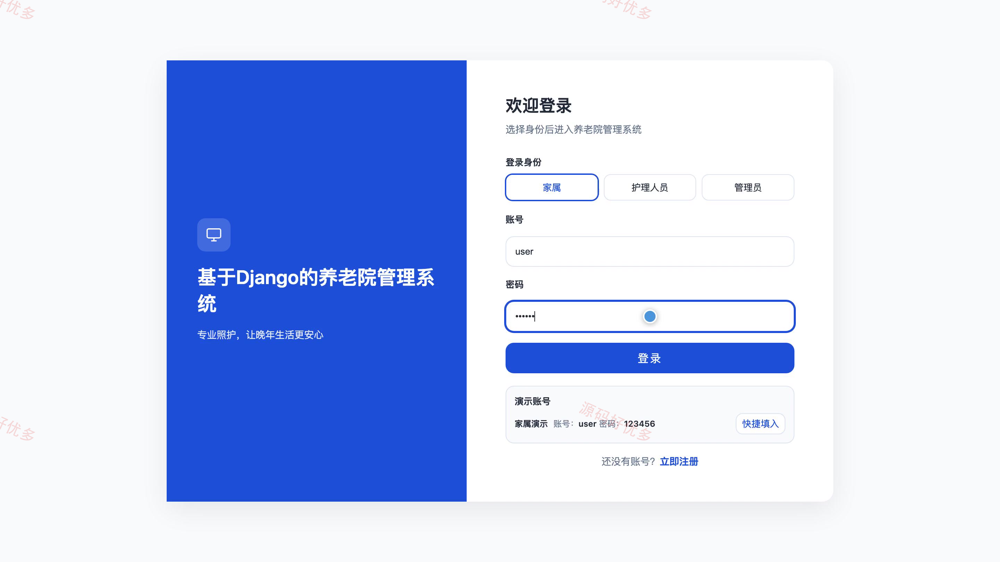
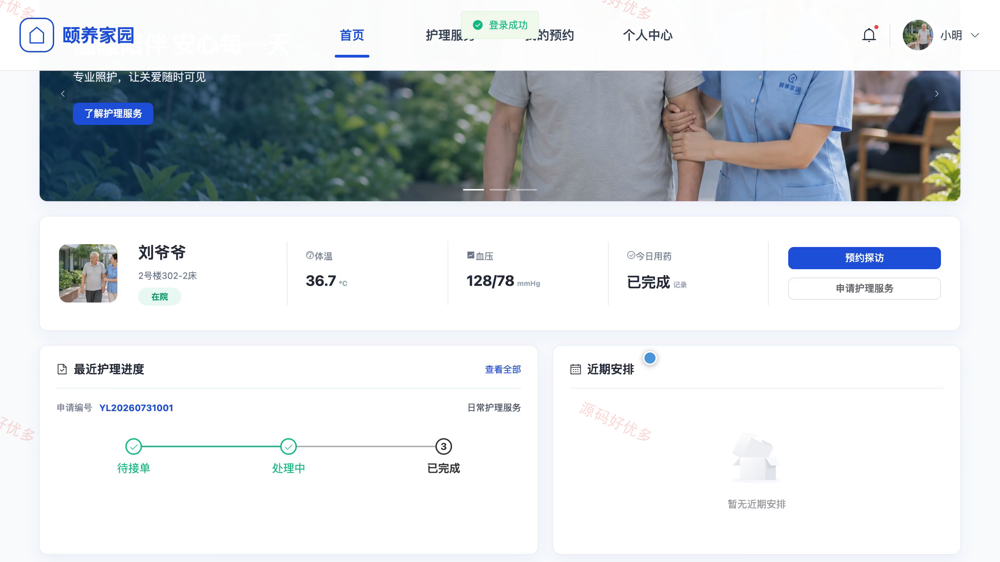
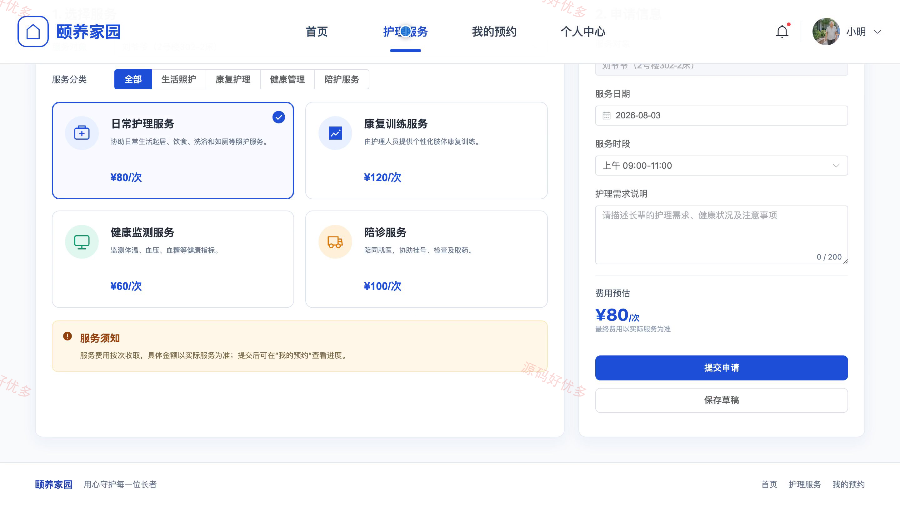
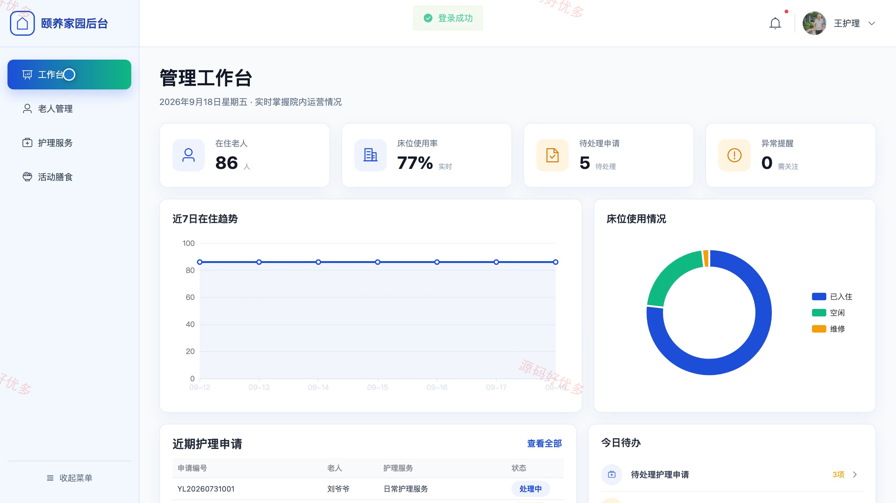
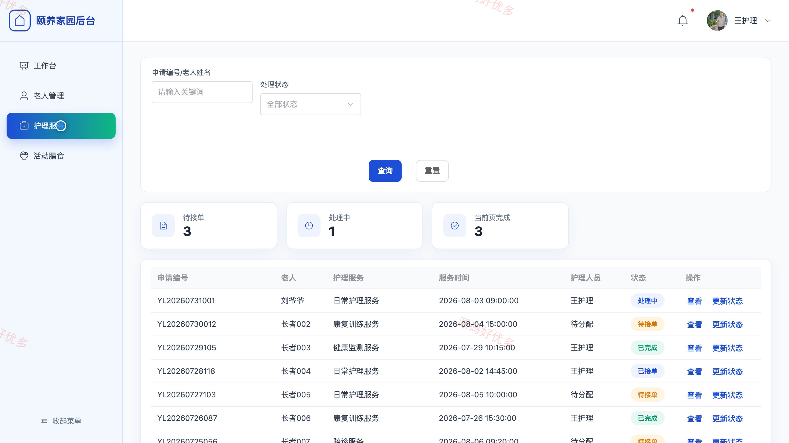
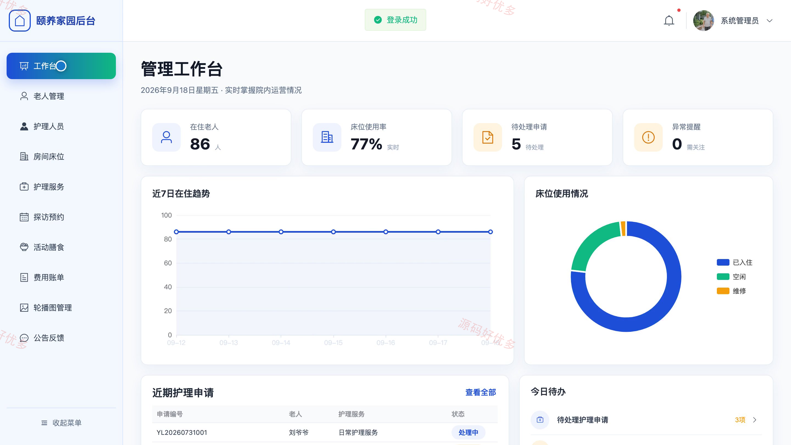
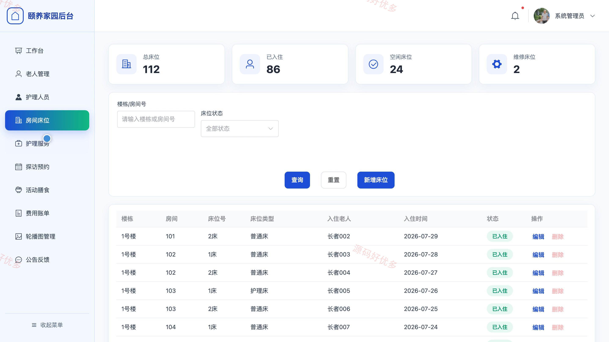

# bs012C
bs012C基于Django的养老院管理系统源码 Python Django Vue3 前后分离
## 源码问题查看主页咨询

### 一、关键词
养老院管理、智慧养老、老人照护、护理服务、探访预约

### 二、作品包含
源码+数据库+万字设计文档+PPT+全套环境和工具资源+本地部署教程

### 三、项目技术
前端技术： Html、Css、Js、Vue3.4、Element-Plus
后端技术：Python、Django

### 四、运行环境要求
开发工具：PyCharm + VSCODE

数据库：MySQL5.7（共15张表）

数据库管理工具：Navicat10以上版本

环境配置软件： Python3+

前端Nodejs：16+

浏览器：谷歌浏览器

### 五、项目介绍
项目编号：bs012C

本系统面向养老院日常照护与家属协同场景，围绕老人档案、床位入住、护理服务、健康记录、探访预约、活动膳食、费用账单和公告反馈建立统一管理流程。家属可在线查看关联老人信息、提交护理和探访申请并跟踪记录；护理人员负责照护任务与健康记录；管理员统筹人员、床位、服务、账单及运营信息。

角色：家属、护理人员、管理员

家属功能：老人档案与健康记录查看、护理服务查看与申请、护理申请进度查询与取消、探访预约与记录查询、活动查看与报名、费用账单查询、院内公告查看、意见反馈与个人资料维护。

护理人员功能：工作台数据查看、老人档案查询、健康记录登记、护理任务查看与处理、活动信息查看、膳食计划查看、个人资料维护。

管理员功能：工作台统计、老人档案与退住管理、护理人员管理、房间床位管理、护理服务与工单管理、探访预约审核、活动膳食与费用账单管理、公告轮播与反馈管理。

### 六、运行截图

